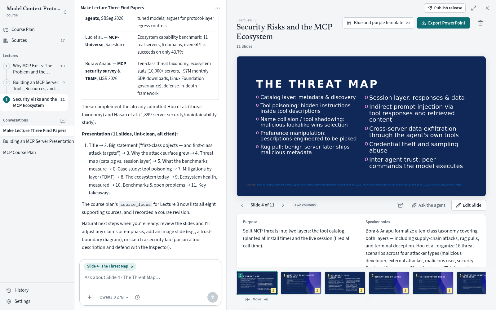
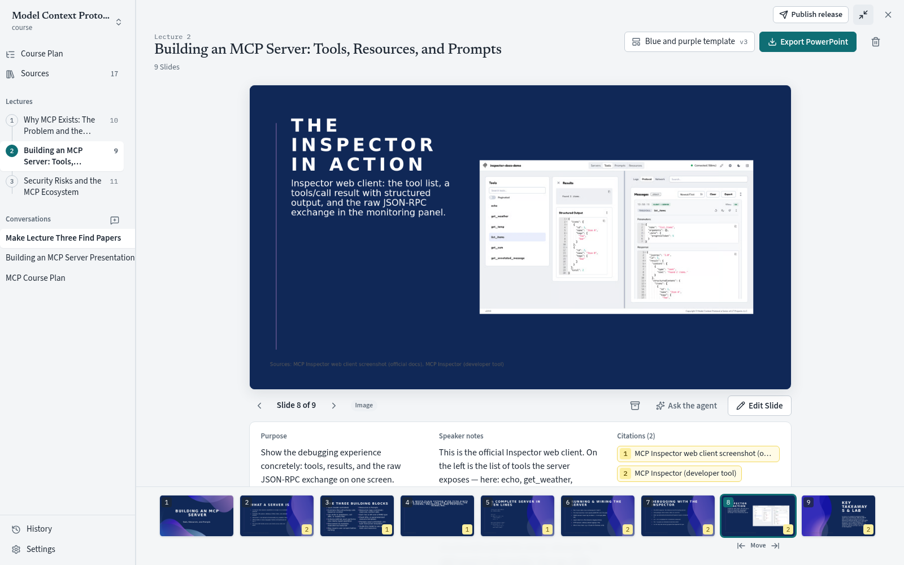
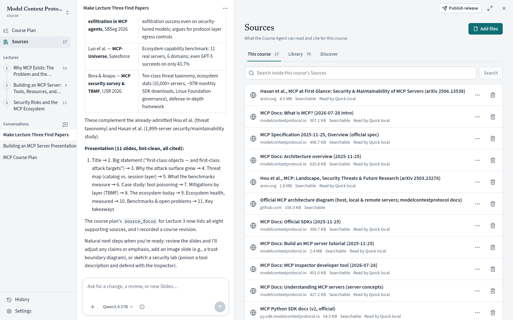
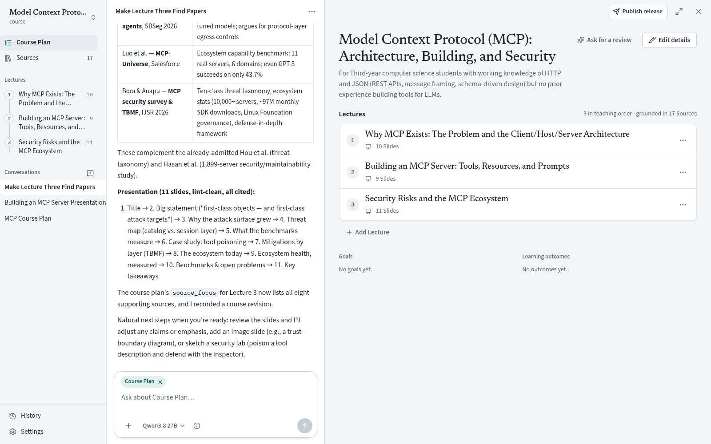
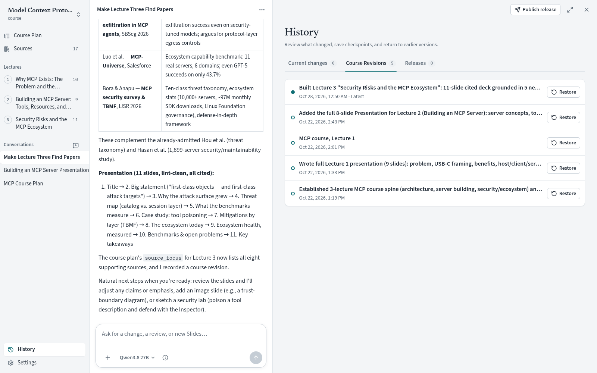

# Course Harness

[](https://pypi.org/project/course-harness/)
[](https://pypi.org/project/course-harness/)
[](https://github.com/martinkozle/course-harness/blob/main/LICENSE)

Course Harness is a local-first application for creating source-grounded Courses in a
human-readable Course Workspace. You plan the Course with a Course Agent, ground it in papers and
documents you choose, and get Lectures with speaker notes and citations that export to PowerPoint
in your own template.



## Examples

Watch a [demo video](https://youtu.be/N4lEOd4WrMM) of a Course built from an empty folder to a
published Course Harness Classroom course, with Lectures, a Quiz and Learner results. The Course
Workspaces of example Courses are public, so you can read what Course Harness produces:

- [System 1 Thinking in Decisions](https://github.com/martinkozle/course-harness-example-system-1-thinking-in-decisions),
  the Course made in the demo video
- [The Model Context Protocol](https://github.com/martinkozle/course-harness-example-mcp):
  architecture, building servers, and security

## Install and launch

Install [uv](https://docs.astral.sh/uv/). It downloads Python 3.14 if you do not have it.

```bash
uvx 'course-harness[pinned]'
```

Or install it as a command-line tool:

```bash
uv tool install 'course-harness[pinned]'
course-harness
```

The `pinned` extra installs exactly the dependency versions each release was tested with, so an
install keeps working as newer dependencies come out.

The command opens `http://127.0.0.1:8765` with the Workspace Launcher, where you create or open a
Course Workspace. Useful options:

```bash
course-harness /path/to/course-workspace  # open a Workspace directly (`.` works too)
course-harness --no-browser               # do not open the browser
course-harness --port 9000                # use another local port
```

On Linux, New course and Open course use `zenity` or `kdialog` to choose a folder. Without either,
pass the folder on the command line instead; an empty folder opens as a new Course.

## Set up a model

Open **Models** to add a provider. Course Harness works with OpenRouter, OpenAI, Anthropic, Amazon
Bedrock, and any OpenAI-compatible server. Under **Found on this computer**, it lists the provider
credentials it can see and lets you add each one with a single click. It looks at
`OPENAI_API_KEY`, `ANTHROPIC_API_KEY`, `OPENROUTER_API_KEY`, `AWS_BEARER_TOKEN_BEDROCK`, AWS session
variables (such as those set by awsume), and the profiles in `~/.aws`. None of these is used until
you add it.

For Bedrock, an AWS profile is the most robust choice: only its name is stored, and the AWS SDK
refreshes SSO and role credentials by itself. Session variables are read from the shell that
started Course Harness, so after they expire, refresh them and restart from that shell. Prompt
caching is turned on for Anthropic and OpenRouter models, and for Bedrock models that support it.

To use an OpenAI-compatible provider on another machine over plain HTTP, select **Allow HTTP to
another host**. The API key and Course content are then sent unencrypted, so use it only on a
network you trust.

## What it does

- **Sources**: add PDF, `.pptx`, `.docx`, and web pages, or discover papers through arXiv,
  Crossref, Semantic Scholar, and OpenAlex. Documents are read quickly on your device first. When
  a document looks scanned, image-heavy, or garbled, you can reprocess it with full Docling (an
  optional extra) or a hosted processor: LlamaParse, Mistral OCR, or one of your Model Presets.
  A hosted processor gets a document only after you agree to send documents to that vendor.
- **Course Agent**: plans the Course, researches sources, and writes Lectures. Only Sources added
  to the Course can be cited.
- **Connectors**: web search and page reading through remote MCP servers. Exa is set up by default
  and works without a key.
- **Publish**: name a checked Release in one dialog. Your edits are saved as a Course Revision
  on their own first, and the header shows how many changes the next Release would include.
- **Sync**: push the Course, its history, Releases, and their PowerPoint files to a Git remote
  (such as a GitHub repository) and receive changes made elsewhere, using your own Git sign-in.
  With the GitHub CLI signed in, Course Harness can create the repository for you. Nothing is
  pushed until you choose **Sync**, or tick **Push to …** when you publish. From a terminal in the
  Course folder, pushing is close to:

  ```bash
  git push origin main 'refs/tags/course-release/*' 'refs/course-harness/release-files/*'
  ```

  Each Release's files travel in their own ref, never in the Course branch. Pushing
  from the app also records those refs for Releases published by earlier versions. Sync
  receives changes only when your Course can simply move forward to them; when this computer
  and the remote both changed, it changes nothing and lets you choose which version to
  keep.

  Upgrade any Course Harness Classroom that serves your Course before you publish with a newer
  Course Harness: a Classroom refuses Releases whose manifest has fields it does not know (this
  version adds release notes).
- **History**: see and restore earlier Course Revisions and Releases.

<table>
  <tr>
    <td width="50%"></td>
    <td width="50%"></td>
  </tr>
  <tr>
    <td align="center">Slides with purpose, speaker notes, and citations</td>
    <td align="center">Sources the Course Agent can read and cite</td>
  </tr>
  <tr>
    <td width="50%"></td>
    <td width="50%"></td>
  </tr>
  <tr>
    <td align="center">The Course Plan</td>
    <td align="center">Course Revisions you can restore</td>
  </tr>
</table>

Canonical Course state lives in readable files in the Course Workspace. Caches, conversations, and
credentials live in platform-native user locations outside it; credentials go to the operating
system keyring when one is available. **Settings → Diagnostics** shows the exact locations.

## Optional extras

**Full Docling for difficult PDFs.** For scanned PDFs, tables, and multi-column layouts you can
reprocess a document with full Docling, which runs layout, table, and text recognition models
locally:

```bash
uv tool install --torch-backend cpu 'course-harness[pinned,docling]'
```

`--torch-backend cpu` installs the CPU build of PyTorch. Without it, uv installs the CUDA build
on Linux, which downloads several gigabytes of GPU libraries. Course Harness asks before it
downloads the Docling models.

**LibreOffice** (`libreoffice` or `soffice` on `PATH`) gives high-fidelity slide thumbnails.

## Development

See [CONTRIBUTING.md](https://github.com/martinkozle/course-harness/blob/main/CONTRIBUTING.md)
to run Course Harness from a checkout, run the checks, and publish a release.

## Deploy Course Harness Classroom

Course Harness Classroom serves your published Course Releases to Learners and Instructors through
Share Links. It is self-hosted from this repository with Docker Compose behind a TLS reverse
proxy; see
[Deploy Course Harness Classroom](https://github.com/martinkozle/course-harness/blob/main/docs/deploy-classroom.md).

## License

[MIT](https://github.com/martinkozle/course-harness/blob/main/LICENSE)
